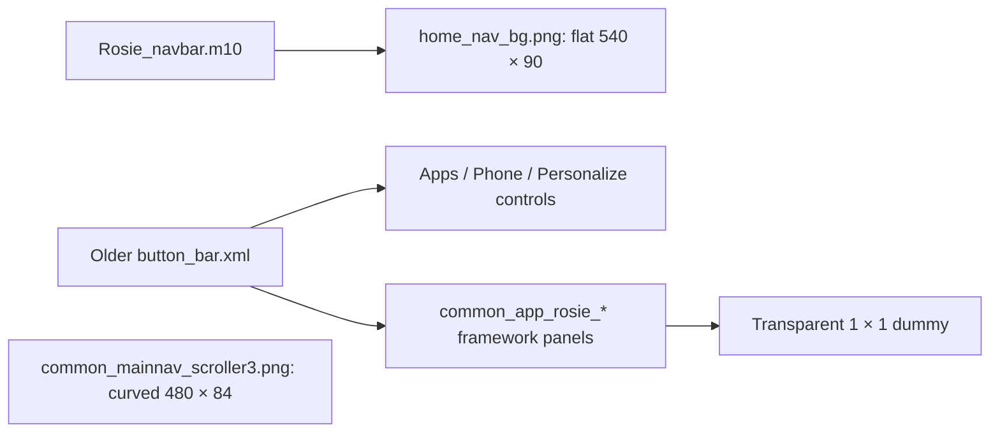

# Curved dock artwork and retained 2D layout

## Finding

The user’s `res/HTC-Sensation-4G-4.jpg` shows a curved three-button dock: app drawer, Phone and Personalize. The supplied ROM **does contain surviving curved artwork**, despite the separately decoded Mode10 background being rectangular. The earlier background-only investigation was insufficient to establish whether matching artwork survived elsewhere.

Recovered unchanged from `system/app/Rosie.apk`:

- `res/drawable-hdpi/common_mainnav_scroller3.png`, resource `0x7f02003d`, 480 × 84.
- `res/layout-port/button_bar.xml`, a separate `com.htc.launcher.widget.ButtonBar` with left, middle Phone, and right Personalize controls.
- Original Phone and Personalize icon drawables.
- `com.htc.launcher.widget.Scrollbar`, including `curveEquation` and a quadratic thumb-position calculation.

The PNG has a curved alpha silhouette. The first nonzero alpha rows at x=0,120,240,360,479 are respectively 25,6,0,5,24. Alpha ranges from 0 to 188. This is evidence of an arch-shaped drawable; it is not proof that this drawable alone supplies the complete glossy dock in the photo, or that it overlays the active Mode10 navbar.

Arc PNG SHA-256: `1c735f9bfb53bae89029010979100b1bcd90b80ac7541742d855cb5d4acd0720`.

## What the resource references show

The three-button layout’s background points to HTC framework resource `0x02080172`, `drawable/common_app_rosie_navbar`. Its left, middle and right button selectors point to the other `common_app_rosie_btn_*` entries. All eight retained framework resources resolve to `drawable/zero_dummy_asset`: a fully transparent 1 × 1 PNG. Thus the layout and icons survive, but their default shared panel artwork is stubbed out in this ROM.



The curved PNG is intentionally not connected to the Mode10 node in this diagram: that binding has not been established.

The retained Java `ButtonBar.onFinishInflate` also performs `CustomResourceUtil.getDrawableResIdentifier` lookups for names such as `bb_btn_left`, `bb_btn_middle`, `bb_btn_right` and `navbar`. This means the default resource table alone does not exclude a runtime-selected customization. It does not prove such a customization exists in this ROM or that it would restore this exact dock.

No portrait/landscape XML directly references the curved drawable’s ID. Across all 57 Rosie Mode10 scenes, there are no DiffuseMap references to the hash of `common_mainnav_scroller3.png`. Those scenes contain Timeline, Null, NinePatchSprite, Sprite and Text nodes, with no nonempty MeshLibrary/MaterialLibrary sections and no recognized mask/clip/shader/effect/material property names. This is a static audit, not a full original-Sense runtime trace: dynamic Java/native bindings remain possible.

## Why an overlay is not the same as a mask

A conventional source-over layer cannot erase the rectangle underneath it. Combined alpha is `a_top + a_base × (1 − a_top)`. Where the curved PNG’s upper corners are transparent, the underlying bar is still visible. A missing mask, replacement skin background, or an older rendering path could behave differently, but this investigation has not confirmed one of those explanations for the user’s historical experience.

The recovered PNG provides real outline data for reconstructing the arc on modern Android. The reference photo can guide the missing panel highlights and three-button arrangement. That would be a reconstruction using source evidence, not a claim that a complete hidden Mode10 dock was recovered.

## Reproduce and review

```sh
source tools/android-env.sh
python3 tools/decode_navbar.py
python3 tools/audit_dock_layers.py
```

The audit uses Python’s standard library and SDK Build Tools 35.0.0 `aapt2`. Original assets and generated reports stay under ignored `references/3.33.401.153/dock-layer-audit/`:

- `layers.json`: exact resource aliases, hashes, alpha contour samples and all-scene audit counts.
- `common_mainnav_scroller3.png`: the untouched curved drawable.
- `comparison.html`: reference photo, recovered arc, and toggles for placing it over the previously decoded flat background. Both textures are scaled to the same width and bottom-aligned for inspection; this is not original decoded placement.
- `button_bar-xmltree.txt` and `bb_btn_*-xmltree.txt`: decoded layout and selector references.
- `Rosie-resources.txt` and `HTC-resources.txt`: complete resource-table dumps.

The comparison requires the preceding navbar decode to supply its flat texture. It does not change any image pixels or install anything into the launcher.

During the investigation, native `dexdump` rejected Rosie’s DEX version 036. For disassembly only, a separate ignored copy was labeled 035 and its header SHA-1/Adler-32 recomputed. That copy was not installed or executed; the original APK and DEX remain unchanged. The inspected Scrollbar methods show quadratic thumb placement; they do not establish the full dock background composition. The repeatable main audit does not require that compatibility disassembly.

## Validation

The indexed-PNG alpha reader matched Pillow on all 40,320 pixels of the recovered arc. All eight default panel aliases were checked as pointing to the dummy drawable; all 57 Rosie scenes were parsed and examined. The comparison’s local image paths were checked. Its browser interaction has not been automated. The read-only audit did not change the launcher. The current renderer uses the recovered curve to bend the dock and button surfaces; see [DOCK-RENDERING.md](DOCK-RENDERING.md).
